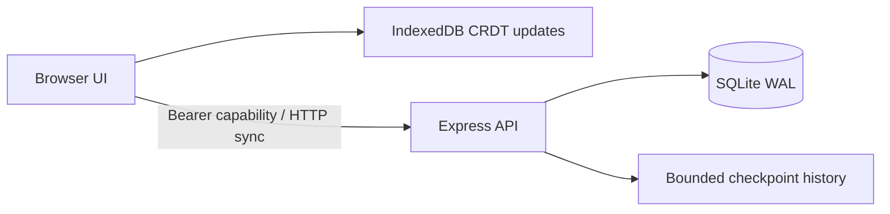

# EvidenceDesk

**Evidence-based research workspace.** A working local application built with AI assistance, with source code, repeatable tests and documented engineering tradeoffs.

## What it does

Text and PDF ingestion; SHA256 deduplication; same-title source versioning; BM25 passage ranking; page and version citations; inspectable source pages; abstention; shared research notebook.

## Run it

Requires Node.js 24.13.1 or newer and npm. Initial installation requires internet. No GPU, paid account or API key is required.

```sh
git clone https://github.com/Aaroh08/evidencedesk.git
cd evidencedesk
npm ci
npm run build
npm test
npm start
```

Open **http://127.0.0.1:5073**. On Windows you can also run `start.ps1` after `npm ci`. Keep the terminal open. Ctrl+C stops the application. Database files are created in ignored `data/`. Stop the server before copying the entire data directory for a local backup; protect both database backups and invite links.

Create a research collection. Load the fictional sample and add it to the collection. Ask how long backups are retained, inspect the cited page, then ask about an unrelated topic. Add an edited source with the same title and compare current versus historical versions.

## Architecture



PDF.js extracts text in a child process with a 15-second timeout. Limits are 2 MB input PDF, 80 pages, 500,000 extracted characters and 40 versions per collection. Text is split into overlapping 140-word chunks with 100-word stride, ranked with BM25, filtered at 50% query-term coverage and deduplicated by page. Latest versions are used by default. The stored hash covers normalized extracted pages, not the original PDF bytes. Original PDFs are not retained.

The shared document syncs every 1.5 seconds. Updates merge server-side with Yjs and persist in a transaction together with a checkpoint. Retrying an unchanged update is idempotent. The latest 100 checkpoints are retained per workspace; current document state is limited to 1 MB. This single-process design favors maintainability and demonstration over horizontal scaling.

## Verification

`npm run check` rebuilds the browser bundle and runs the Node test suite. Tests use real HTTP servers, SQLite, authentication middleware and CRDT updates. See [recorded test output](artifacts/verification.txt). GitHub Actions repeats the build and tests on Linux/Node 24. Tests cover access isolation, cross-origin rejection, malformed sync updates, idempotent retries, invite rotation, database restart recovery and ten independently edited clients.

See [verification notes](docs/VERIFICATION.md) for completed browser checks and their limits. A passing test suite is evidence for the cases exercised, not a promise of zero defects.

## Access and privacy

Workspaces use random 256-bit bearer capabilities. Only a SHA256 token hash is stored server-side. The browser keeps the invite in local storage and the URL fragment. Anyone with the invite has full workspace access, including key rotation. Replace the invite key to revoke old server access; this cannot erase copies already downloaded by collaborators. There are no user accounts, role-based permissions or account recovery.

No analytics or remote AI calls are implemented. Code, notes and document contents are stored locally in SQLite and browser storage as applicable. Do not treat this as an encrypted vault. Use fictional content for public demos. All SQL values use bound parameters, and rendered source passages are escaped.

## Scope and production readiness

Retrieval is lexical and extractive, not semantic or generative. It can miss synonyms and may return passages that mention a topic without answering the question. Query term coverage is a heuristic, not calibrated confidence. The tool does not determine truth, reconcile contradictions or guarantee answer support. OCR, web crawling, embeddings and external AI APIs are not implemented. Research search requires the server; only the notebook supports offline editing.

This is a tested portfolio application, **not a certified production service**. Before an internet deployment, add named-user authentication and authorization, TLS, deployment-specific origin/host controls, stronger per-user quotas, backup/restore drills, security review, monitoring, privacy/retention controls and realistic load testing. Node's built-in SQLite API is experimental in the tested runtime. No availability SLA, penetration-test certification or production-scale performance claim is made.

## Repository guide

- `src/server.mjs`: project API and entry point.
- `src/core.mjs`: persistent workspaces, access control and sync protocol.
- `src/client.js`: project-specific UI.
- `src/shared.js`: local persistence and synchronization.
- `tests/`: reproducible integration and regression tests.
- [Architecture and operations](docs/ENGINEERING.md)
- [Demo and interview guide](docs/DEMO.md)
- [Security model](SECURITY.md)

## References

- [Yjs shared data and persistence](https://docs.yjs.dev/)
- [Node SQLite API](https://nodejs.org/download/release/latest-v24.x/docs/api/sqlite.html)
- [QuickJS WebAssembly bindings](https://github.com/justjake/quickjs-emscripten) (CodeRoom)
- [Mozilla PDF.js](https://github.com/mozilla/pdf.js) (EvidenceDesk)

## Retrieval diagnostic

Run `node evaluate.mjs` for the ten-question authored diagnostic. Results are saved in [retrieval-evaluation.json](artifacts/retrieval-evaluation.json). It includes unanswerable questions and a synonym-only question to expose lexical limitations. This is a small development fixture, not independent research validation.
